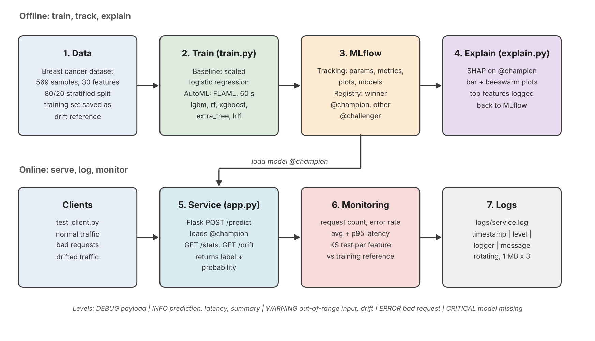

# From AutoML to a Monitored, Explainable Model

DAM405 Programming Assignment 3. An end-to-end workflow on the scikit-learn
**breast cancer** dataset (569 samples, 30 features, malignant vs benign):

1. **Train**: a logistic-regression baseline and a FLAML AutoML search.
2. **Track**: both runs go to MLflow, and both models are registered
   (the winner gets the alias `@champion`, the other `@challenger`).
3. **Explain**: SHAP on the champion model, with plots logged to MLflow.
4. **Serve**: a Flask API loads `@champion` from the registry and has structured
   logging, monitoring (request count, error rate, latency) and KS-test drift detection.



## Project structure

| File | Purpose |
|---|---|
| `config.py` | Shared settings: MLflow store, model name and alias, logger setup |
| `train.py` | Baseline + FLAML AutoML, MLflow tracking, registers both models |
| `explain.py` | SHAP explanation of `@champion`, plots in `artifacts/` and MLflow |
| `app.py` | Flask service: `/predict`, `/stats`, `/drift`, `/health` |
| `monitoring.py` | Request/error/latency counters and the KS-test `DriftDetector` |
| `test_client.py` | Sends normal, invalid, out-of-range and drifted traffic |
| `docs/make_diagram.py` | Regenerates `docs/architecture.png` |

## Setup

```bash
python3 -m venv venv
source venv/bin/activate          # Windows: venv\Scripts\activate
pip install -r requirements.txt
```
On macOS, LightGBM and XGBoost may also need `brew install libomp`.

## Run (in order)

```bash
python train.py                   # about 1-2 min (AutoML budget 60 s; --budget 30 for faster)
python explain.py                 # SHAP plots -> artifacts/
mlflow ui --backend-store-uri sqlite:///mlflow.db     # http://localhost:5000
```
In a **second terminal** (activate the venv again):
```bash
python app.py                     # service on http://127.0.0.1:5001
```
In a **third terminal**:
```bash
python test_client.py            # traffic; then open logs/service.log
```

To see the DEBUG lines: `LOG_LEVEL=DEBUG python app.py`

### Example request
```bash
curl -X POST http://127.0.0.1:5001/predict -H "Content-Type: application/json" \
     -d '{"features": {"mean radius": 14.1, "...": "all 30 features"}}'
```
You can send `features` as a list of 30 numbers in dataset order, or as a
`{feature_name: value}` object.

## Notes
- FLAML's search depends on machine speed, so the chosen model and the exact
  numbers may differ slightly between computers.
- `mlflow.db`, `logs/` and `artifacts/` are created at run time and are git-ignored.

## Libraries used
MLflow, FLAML (Microsoft), scikit-learn, LightGBM, XGBoost, SHAP, Flask, SciPy, pandas, matplotlib.
AI assistance (Claude) was used for code scaffolding, as declared in the report.
